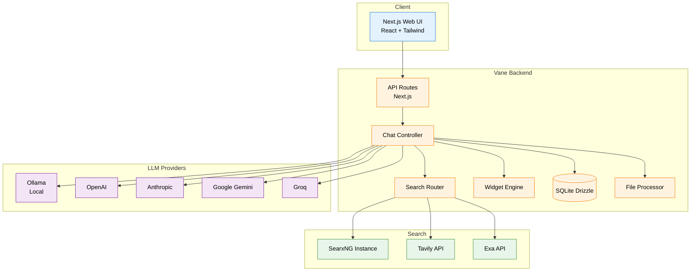

# Vane 🔍

[](https://opensource.org/licenses/MIT)
[](https://hub.docker.com/r/itzcrazykns1337/vane)
[](https://discord.gg/26aArMy8tT)

Vane is a **privacy-focused AI answering engine** that runs entirely on your own hardware. It combines internet knowledge with support for **local LLMs** (Ollama) and cloud providers (OpenAI, Claude, Gemini, Groq), delivering accurate answers with **cited sources** while keeping your searches private.


## ⚡ Key Features

- **Multi-provider LLMs** — Use local (Ollama) or cloud (OpenAI, Claude, Gemini, Groq) models, or mix them
- **Private web search** — Powered by SearxNG, no identity leakage
- **Smart search modes** — Speed, Balanced, and Quality modes for different use cases
- **Rich widgets** — Weather, stock prices, calculations, and more
- **File uploads** — PDFs, text files, images — ask questions about your documents

## 🏗 Architecture



## 📦 Installation

### Docker (Recommended)

```bash
docker run -d -p 3000:3000 -v vane-data:/home/vane/data --name vane itzcrazykns1337/vane:latest
```

With your own SearxNG instance:

```bash
docker run -d -p 3000:3000 -e SEARXNG_API_URL=http://your-searxng:8080 -v vane-data:/home/vane/data --name vane itzcrazykns1337/vane:slim-latest
```

### From Source

```bash
git clone https://github.com/ItzCrazyKns/Vane.git
cd Vane
npm i && npm run build && npm run start
```

> Full docs: [installation](docs/installation), [architecture](docs/architecture/README.md), [API](docs/API/SEARCH.md)

## 🔧 Development

```bash
npm run dev     # Start development server
npm run build   # Production build
npm run lint    # ESLint check
```

## 🌐 Deployment

One-click deployment options available for Sealos, RepoCloud, ClawCloud, and Hostinger. See [docker-compose.yaml](docker-compose.yaml) for self-hosted Docker setup.

## 📚 Citation & Attribution

This project has received funding from the European Union's Horizon Europe research programme (grant No. 101070238).

## 🤝 Contributing

Found a bug or have an idea? Open a [GitHub issue](https://github.com/ItzCrazyKns/Vane/issues) or join our [Discord](https://discord.gg/EFwsmQDgAu). See [CONTRIBUTING.md](CONTRIBUTING.md) for contribution guidelines.
